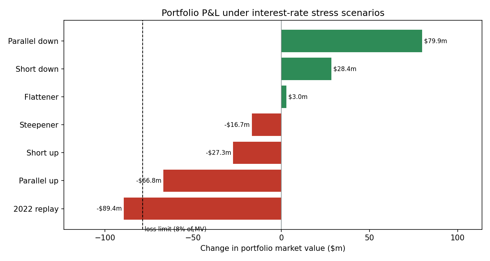
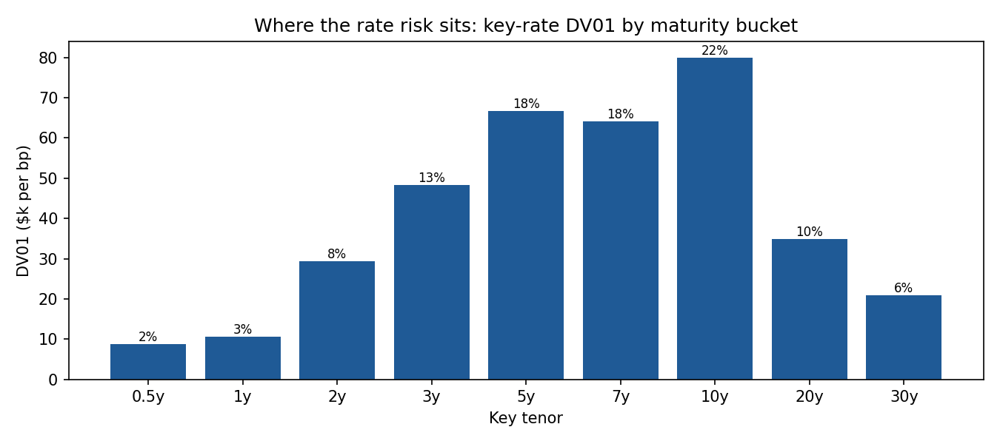
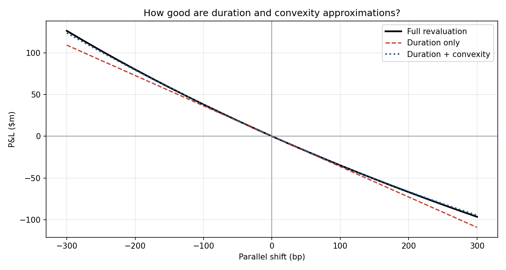

# Portfolio Interest-Rate Stress Test

A Python tool that stress-tests a fixed-income treasury portfolio against
interest-rate shocks, the way a Treasury or market-risk team would. It values
every bond off a bootstrapped Treasury zero curve, applies the six standardised
**IRRBB** shock scenarios plus a **historical 2022 replay**, breaks the risk
down by maturity with **key-rate DV01s**, checks results against **risk limits**
(KRIs), and writes a plain-English summary for non-technical readers.



## What it answers

| Question | Output |
|---|---|
| How much do we lose if rates jump 200bp, or if 2022 happens again? | `scenario_results.csv`, `scenario_pnl.png` |
| Which bonds drive the loss? | `scenario_pnl_by_bond.csv` |
| Where on the curve does our rate risk sit? | `key_rate_dv01.csv`, `key_rate_dv01.png` |
| Are we inside our risk limits? | `kri_limits.csv` (OK / WARN / BREACH) |
| Can we trust duration-based shortcuts? | `approximation_check.png` |
| What should leadership take away? | `summary.md` |

## Results on the sample portfolio

Mock portfolio: about $980m of T-bills, Treasury notes and bonds, agencies and IG corporates.

- **Worst case:** replaying 2022's rate move costs **$89.4m (9.1% of market value)**, more than the +200bp parallel shock, because 2022 hit the short and intermediate curve hardest.
- **DV01 ≈ $364k per bp**, effective duration **3.70 years**.
- **58% of rate risk** sits in the 5y–10y buckets.
- **2 limit breaches** (DV01, worst-case loss) and 1 early warning (duration).
- Duration alone misstates the +200bp loss by $5.9m; adding convexity cuts the error to under $0.6m.

Full write-up: [`output/summary.md`](output/summary.md)

| Key-rate DV01 | Duration vs full revaluation |
|---|---|
|  |  |

## How it works

1. **Curve:** Treasury par yields (CMT tenors) are bootstrapped into a semi-annual zero curve on a 6-month grid.
2. **Valuation:** each bond's cash flows are generated backwards from maturity and discounted at zero rate + bond spread (full revaluation, no approximations).
3. **Scenarios:**
   - *IRRBB (BCBS 2016):* parallel up/down, steepener, flattener, short up/down, using the USD shock sizes (parallel 200bp, short 300bp, long 150bp) applied to the zero curve.
   - *Historical:* the end-2021 to end-2022 change in Treasury par yields added to today's curve, then re-bootstrapped.
4. **Risk measures:** effective duration, convexity and DV01 by curve bumping; key-rate DV01s with triangular bumps, which add up to the parallel DV01 (checked in the tests).
5. **KRIs:** limits in `data/limits.json`; status is WARN at ≥80% utilisation and BREACH above 100%.

## Run it

```bash
pip install -r requirements.txt
python run_stress_test.py                 # sample portfolio + curve
python run_stress_test.py --live          # live Treasury curve via yfinance
python run_stress_test.py --portfolio my_bonds.csv --curve my_curve.csv --as-of 2026-11-17
python -m pytest -q                       # 11 tests
```

Inputs:
- `data/portfolio.csv`: `bond_id, description, sector, face_value, coupon_pct, maturity, frequency (0 = zero-coupon), spread_bps`
- `data/base_curve.csv`: `tenor_years, par_yield_pct`
- `data/limits.json`: DV01, duration, max scenario loss (% of MV), max key-rate bucket share

## Project structure

```
ratestress/
  curve.py       par curve, zero-curve bootstrapping, optional live fetch
  portfolio.py   cash-flow generation and full revaluation
  scenarios.py   IRRBB shock shapes and the 2022 historical replay
  risk.py        duration/convexity/DV01, key-rate DV01, scenario engine, limit checks
  report.py      charts and the plain-English summary
run_stress_test.py   command-line entry point
tests/               pytest suite
data/                sample portfolio, curve and limits
output/              generated results (sample run included)
```

## Limitations

- Holdings and the base curve are illustrative. Use `--live` or your own curve file for current data.
- Rate risk only: credit spreads are held constant, and there is no optionality (no callable bonds or MBS).
- Post-shock rates are floored at 0%, a simplification of the Basel floor.
- Values are instantaneous shocks. There is no time decay, carry or rebalancing.
- The 2022 yields are approximate year-end CMT values. Verify them against the U.S. Treasury Daily Par Yield Curve before quoting.

## Background

This builds on the risk-metrics module (duration, DV01, convexity) I wrote for
a team bond-analytics project in FE 520 at Stevens, and extends it from a single
bond to portfolio-level, scenario-based stress testing.
